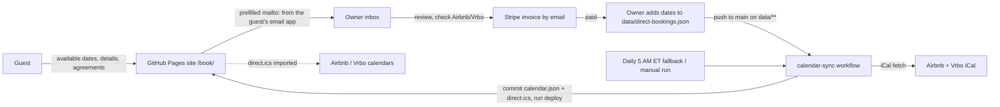

# Blue Bliss By The Bay

A mobile-first vacation-home website built with React, TypeScript, Vite, and Tailwind CSS 4. **Enquire direct** opens a chat-style guided availability intake, available throughout the site and at `/book/`. It is a deterministic form, not AI or a live human. Guests enter preferred dates, guests, name/email and optional notes, review the summary, then explicitly open an email draft to the configured request inbox. **They must press Send in their own email app.** Airbnb remains a secondary option. An enquiry does not verify availability or price, hold dates, or take payment. The existing Bliss Sync calendar and request-to-book implementation are retained for later, but are not the current `/book/` experience.

## Develop and validate

- `npm install` installs the stack. Bliss Sync added one application dependency, `react-day-picker`, and now uses the existing `react-router-dom` for the booking and policy pages.
- `npm run dev` starts development at the configured Vite base path.
- `npm run build` runs TypeScript checks and creates the production output.
- `npm run lint` runs ESLint.
- `npm test` runs the Node test runner over the Bliss Sync booking logic (iCal parse/merge, overlap detection, the 7-day rule, pricing estimates, request validation and email, tax CSV). Requires Node 22.18+ (TypeScript type stripping).
- The [base-path checks](scripts/base-check.mjs) verify development image helpers and generated production metadata for root, GitHub Pages, and alternate subpath deployments without overwriting the production build. They run as part of the VS Code validation task.
- `npm run preview` serves the production build.
- `node scripts/browser-check.mjs` runs the dependency-free headless Chrome regression checks after a build. Requires Node 22+ and Chrome; set `CHROME_PATH` on non-macOS systems. It starts an isolated browser and a local preview if necessary, cleans them up, and prints a temporary report/artifact directory. Optional axe-core is fetched from a pinned CDN version for testing only; use `--no-axe` for offline checks. No Airbnb booking is submitted.
- `node scripts/browser-check.mjs --intake-only` checks the production preview's guided flow at 320/390/1440px: validation, editing/back, minimize/reopen, client-side navigation, reset/reload, encoded recipient, copy success/unavailable fallback, native dialog focus/Escape, and six axe states. Add `--live --url=https://dwconnolly.github.io/tampa-airbnb/` for the deployed journey. Tests use synthetic inputs in browser memory, never activate the email link, and save screenshots without contact details. The older `--ui-only` and `--enquiry-only` scenarios document previous calendar/mailto-only interfaces and are not checks for the current intake.
- The equivalent validation (tests, build, lint, base-path checks), preview, and browser-check tasks are available in [the VS Code tasks](.vscode/tasks.json).

## Content and trust

Edit [src/config/siteConfig.ts](src/config/siteConfig.ts) for property facts, sleeping arrangements, amenities, guest quotes, FAQs, navigation, booking URL, and page/SEO copy.

- Three bedrooms are separate from `additionalSleeping` (the loft sofa bed). The total capacity is six, not an invitation to add extra guests.
- Supplied guest quotes are retained without rewriting. The page labels them as host-supplied and links to the current Airbnb review history.
- `trust` retains the historical rating, review count, and Superhost claim, but each badge is **off by default**. Confirm the value against Airbnb, set that field’s `verified` flag, and record `verifiedAt` as an ISO date. Both flag and date are required to display the badge. Dates are shown publicly; recheck regularly.
- `ownerVerification` lists outstanding checks. Verify review attribution/permission, bed sizes and loft layout, amenities, parking limits, fire pit instructions, listing URL, and production domain.
- Arrival/departure times, pets, smoking, events, quiet hours, and cancellation terms are intentionally deferred to Airbnb until confirmed. Old unverified times, instant-booking/free-cancellation promises, stock photos, geographic coordinates, and structured ratings have been removed. No JSON-LD is emitted; add it only when its facts are verified.
- The home is a Tampa Heights neighborhood property, not beachfront or waterfront. Destination recommendations carry no unverified travel-time claims. The neighborhood currently has no imagery; do not put destination photos in the property gallery.

## Photography handoff

The owner supplied a [Lightroom album](https://lightroom.adobe.com/shares/86fb79cab64549df885c04ea983c2eef) containing **56 downloadable photographs**. These were imported on September 12, 2026. The third photo in Lightroom’s custom order, **DSC06600**, is now the hero and first gallery photo, as requested by the owner. The original exterior AVIF remains further into the collection, making **57 gallery images** in total.

### Outdoor-first order and Blue Bliss refresh

**Boutique-stay UI refinement:** an ivory-to-sky, photo-led hero now uses the existing ocean/bliss palette and Georgia/Avenir typography, with more readable supporting text and quieter section transitions. The uncropped, eager hero and the lazy 57-photo gallery keep their existing assets, sizes and modal keyboard behavior. Story, amenity, review, FAQ and footer spacing is refined without changing property facts or guest quotes.

Primary actions in the hero, navigation and closing invitation open the same mounted guided enquiry when a valid inbox is configured, with Airbnb beside them. A persistent site-wide launcher replaces the old mobile booking bar and also appears on policy and enquiry pages. Without a valid inbox, primary actions fall back to Airbnb. The widget keeps answers in React memory while minimized and across client-side navigation; reloads, external navigation and closing the tab clear them. There is no localStorage, sessionStorage, URL/query-string persistence, analytics or backend. “Clear & start over” removes all draft answers. The review step displays the recipient, explicit **Open email to send enquiry** action and **Copy enquiry** fallback; clipboard failure selects the text for manual copying. It never claims delivery.

The intake uses simple preferred-date inputs rather than an availability calendar, and enforces the existing lead time, minimum/maximum nights, booking horizon and six-guest limit using the shared validators. No blocked-date feed is used to claim availability: the owner checks availability and price manually. Check-ins within seven days point to Airbnb. There are no quotes, policy acknowledgements or payment steps in this enquiry. `src/pages/BookPage.tsx` retains the previous calendar/quote/request implementation for a future explicit restoration; switching readiness flags alone does not restore that route. No booking rules, owner confirmations, calendar files or runtime dependencies changed.

The direct action uses the owner-requested “Enquire direct (no fees)” label consistently. Remaining Airbnb action links read “airbnb”; the floating launcher and intake panel are direct-only. The intake omits “Arriving sooner,” the live-chat disclaimer and the repetitive draft-retention footer. Review still explicitly tells guests to press Send in their email app. These are copy-only changes: rates, taxes, cleaning charges, stay constraints, in-memory drafts and the email handoff are unchanged.

Policy pages retain their original text and draft gates, with a numbered table of contents, focusable anchor destinations, a constrained reading measure, and a sticky desktop contents panel.

The hero now pairs “Your Tampa launchpad.” with the uncropped DSC06600 photograph and a short introduction positioning Blue Bliss in Tampa Heights, close to Armature Works. The home-base theme continues through the stay story, neighborhood, closing invitation, and SEO description. The owner’s longer description about coffee, wine/beer, bocce, Armature Works, and the outdoor shower is preserved in the expandable “A note for your stay” section below the image-led story. The “Your Own Place. Your Own Pace.” introduction retains conference, golf, downtown and Tampa Bay as possible outings. Promotional cooking/shared-meal language has been removed; genuine guest quotes remain unchanged.

The editorial composition pairs the light ivory/sky canvas with navy-to-azure chapters, numbered journal captions, asymmetric outdoor/interior photography, unboxed property facts, an inset midnight-blue sleeping chapter, and a sunlit photographic closing invitation. The illustrated skyline has been retired from the hero and neighborhood section: real property photography and restrained destination typography now carry the design. A lightweight local SVG paper texture adds depth; no animated backgrounds, stock photography, or scroll effects are used. Outdoor copy sits beside—not over—the photograph. Every photo opener has a visible, minimum-44px “View photo” action row below its image, including small gallery tiles. No photo action is positioned over image content or hidden on smaller screens. The owner-selected hero stays fully visible at its natural aspect ratio. Composition styles are in [src/App.css](src/App.css); base styles and controls remain in [src/index.css](src/index.css). `photography.storyIds` selects the outdoor, interior, sleeping, and closing images. The home remains in Tampa Heights, not downtown or on the waterfront.

`photography.priorityIds` controls the front of the full collection; `photography.previewIds` controls the five page previews. Current first five: **DSC06600, DSC06560, DSC06562, DSC06590, DSC06584**. Local Apple Vision classification strongly supports the table/chair/patio selections and identifies **DSC06560 / DSC06562 as likely shower views**. This is not a direct visual review: the owner should confirm those two shower filenames. Their public captions remain neutral rather than presenting classifier guesses as facts. Remaining photos preserve their prior relative order.

All imported photos are local WebP assets in [public/images/property](public/images/property), with real 640 × 427, 1280 × 853, and 2048 × 1365 exports. The full set of 168 renditions is about 17.3 MB; it is **not** downloaded on initial page load. Five gallery previews and four editorial images are lazy-loaded below the eager hero. The full viewer loads the selected image on demand, with responsive source selection, previous/next buttons, left/right arrow keys, a live counter, and a labeled jump selector. The modal image is unmounted when closed. No Lightroom login, hotlinked renditions, or expiring Adobe URLs are required by the deployed site.

**Caption review needed:** Lightroom supplies filenames and copyright metadata, but no room descriptions. Images therefore have distinct neutral property-album labels and source references; these are not a substitute for descriptive room-specific alt text. Supply a filename-to-room/photo-description key, especially for the three named bedrooms and the loft. Do not infer bed sizes, accessibility, or amenities from filenames. Photo contents/crops have not been visually reviewed by the automated checks. Confirm the album’s coverage of the loft sofa bed, bathrooms, parking, and entrance. The user supplied the album for use on this site; confirm that your photo license permits publication without attribution.

The reproducible [scripts/import-lightroom.py](scripts/import-lightroom.py) downloads public 2048-pixel renditions and creates the local WebP sizes with Pillow. Pillow is photo-tooling only, not an application dependency. It strips EXIF/GPS and prints an inventory; it does not rewrite site content. Review album changes before rerunning (existing imported renditions are replaced). Original Lightroom filenames are retained as local file stems, and `albumPhotoFiles`, `photography`, captions, and preview selections live in [src/config/siteConfig.ts](src/config/siteConfig.ts).

To add a photo:

1. Put optimized files in [public/images](public/images). Prefer AVIF/WebP, with sensible dimensions and compression.
2. Add one `galleryImages` entry with a unique `id`, public-relative `src` (for example `images/kitchen.avif`), factual `alt` and `caption`, and the actual pixel `width`/`height`.
3. Optionally add `sources` containing real exports of the same photo at different widths. `PropertyImage` generates `srcSet` and uses context-appropriate `sizes`; never list a width that does not match the file.
4. Keep at least one image. The first is the hero. Choose the compact page preview using `photography.previewIds`; every gallery entry is available in the full viewer. Add accurate captions and alt descriptions rather than copying the provisional album labels.
5. Confirm every source in both development and the production preview. Below-fold gallery images are lazy-loaded and dimensioned; the hero is loaded eagerly with high priority. The full image is available in a native modal dialog with Escape, focus restoration, and background isolation.

Neighborhood photos, if supplied later, must be separately configured/rendered in the neighborhood section, licensed for use, and captioned as destinations **not at the property**. Do not add stock hotel, pool, beach, or restaurant imagery to suggest amenities.

## Bliss Sync: direct booking requests

The following describes the **retained future booking capability**, not the currently exposed guided enquiry. In-house calendar sync and **request-to-book** use **no server of any kind**: no PMS, no SaaS, no Worker, and no payment on the website. The site stays static on GitHub Pages. The retained booking form lets guests pick dates and email a request; the owner reviews it and replies with a **Stripe invoice** sent manually from the Stripe Dashboard. Nobody is charged until the owner accepts and the guest pays that invoice.

**Rules (enforced in the site calendar):** booked nights and check-ins within 7 days (`rules.minLeadDays`) simply cannot be selected. Shorter-notice stays go to Airbnb (and Vrbo once `externalLinks.vrboListing` is set). The calendar also enforces the minimum/maximum stay and booking horizon, and the guest picker allows at most 6 guests. The owner reviews every request before invoicing, which is the real check.

| Piece | Where | What it does |
| --- | --- | --- |
| Booking logic | [shared/booking/](shared/booking) | Pure, unit-tested TypeScript shared by the site and the Actions scripts (dates, iCal, calendar merge/overlaps, rules, pricing estimate, request email, tax report). |
| Owner data | [data/](data/README.md) | `booking-config.json` (rates incl. weekend/seasonal, cleaning fee, tax lines, rules, `directBooking.enabled` + `requestEmail`, owner confirmations), `owner-blocks.json`, `direct-bookings.json` (request reference, dates and status only; **no guest PII**). Edit by pull request or the GitHub web editor. Git history is the audit log. |
| Calendar sync | [.github/workflows/calendar-sync.yml](.github/workflows/calendar-sync.yml), [scripts/sync/calendar-sync.ts](scripts/sync/calendar-sync.ts) | **Event-driven:** runs on every push to `main` that touches `data/**` (an approved booking, a block, a rate change) and on the manual **Run workflow** button (also in the GitHub mobile app). **Fallback:** daily at 05:00 `America/New_York` (the schedule's `timezone` option keeps it at 5 AM local across daylight-saving changes). A concurrency group serialises runs. It fetches the Airbnb/Vrbo iCal, merges direct bookings and owner blocks, writes [public/calendar.json](public/calendar.json) (blocked nights by source) and [public/direct.ics](public/direct.ics) (direct bookings + owner blocks for the OTAs to import), commits, and runs the Pages deploy. |
| Guards | same | A failing or stale feed keeps the last good dates for that source. Overlapping bookings stay blocked (union) and are reported. Invalid data files fail the run without publishing. Each problem opens or comments on a GitHub issue labelled `bliss-sync`; requests close automatically (`booking.open: false`) while required feeds are stale. |
| Site | `/book/`, `/policies/*` | `/book/` now opens the guided availability enquiry, including with `?preview`; no placeholder quotes are exposed. Policy routes remain unchanged. The older `BookPage.tsx` form, estimated quotes and four acknowledgements remain in source for later restoration, not active routing. |
| Tax report | [.github/workflows/tax-report.yml](.github/workflows/tax-report.yml) | Monthly CSV of confirmed direct bookings (by check-in month) from `direct-bookings.json`, with an **estimated** lodging/cleaning/tax split from current rates. Reconcile it against the paid Stripe invoices before filing. Kept as a workflow artifact for 400 days. |

**Why `mailto:`.** It is the only way to deliver a request from a static site without running or renting a service: form backends (Formspree, Google Forms, etc.) are hosted SaaS, and GitHub issues would publish guest details. The guest's own email app sends the request, the website stores nothing (no cookies, no local storage), and the owner gets a normal email to reply to. Downsides: it needs an email app on the guest's device (hence the copy fallback), and the request address is public, so use a dedicated alias.

**Placeholder figures.** Nightly/weekend rates, cleaning fee and the three tax lines in `booking-config.json` (Florida sales tax, Hillsborough County discretionary surtax, Hillsborough County tourist development tax) are **placeholders, not verified legal rates**. Confirm them with Florida DOR / Hillsborough County (and a tax adviser), then set the matching `ownerConfirmations` flags. The site will not open requests while any confirmation is `false`. The guest sees an estimate; the Stripe invoice is the final price.

**Policies.** Cancellation, house rules, rental terms and privacy pages ([src/config/policies.ts](src/config/policies.ts)) are drafts written for the request → invoice flow. Each shows a "draft" banner and lists "Owner to confirm" items until `ownerConfirmations.policies` is `true`. Bump `termsVersion` whenever terms change; the request email quotes the version the guest agreed to.

### Approving a request (owner routine)

1. Read the request email. Check the dates are still free on Airbnb/Vrbo and in `calendar.json` (requests do not hold dates).
2. Reply to accept or decline. To accept, create a Stripe invoice in the Dashboard (line items from the estimate in the email, your confirmed taxes, a due date) and send it to the guest's email.
3. When the invoice is paid, add `{ "id": "<reference from the email>", "checkIn": "YYYY-MM-DD", "checkOut": "YYYY-MM-DD", "status": "confirmed" }` to `data/direct-bookings.json` and commit to `main` (GitHub web editor is fine). That push runs the sync, which blocks the dates on the site and in `direct.ics`. To hold dates before payment, add an owner block instead.
4. To cancel, set `"status": "cancelled"` and refund in Stripe per the cancellation policy.

### Trade-offs of the serverless request flow

- **No payment or hold on the site.** Dates stay open until the owner records the booking, so two guests can request the same dates; the owner decides. Nothing is charged automatically and no refunds happen automatically.
- **Double-booking window with the OTAs.** Airbnb/Vrbo pick up `direct.ics` on their own import schedule, and Airbnb/Vrbo bookings reach the site calendar only on the daily 5 AM fallback or a manual run: GitHub cannot be triggered by an OTA or by email without a hosted relay, which this setup deliberately avoids. Run the workflow manually after an OTA booking email to shorten the window, and always check the OTAs before invoicing.
- **Rules are enforced in the UI only.** A determined guest could email anything; the owner's review is the gate.
- **`mailto:` depends on the guest's email app** (copy fallback provided); the request address is public.
- **Estimates, not quotes.** The site figure and the tax report use current config rates; the Stripe invoice is authoritative.
- **Scheduled runs can start late.** GitHub may delay scheduled workflows during busy periods. The schedule `timezone` option is in public preview; if it ever stops being honoured the run would happen at 05:00 UTC instead (01:00 or 00:00 Tampa time), which the "Log local run time" step makes visible.

### Secrets (never in the site bundle or repo)

- **GitHub Actions secrets:** `AIRBNB_ICAL_URL` (required), `VRBO_ICAL_URL` (optional until Vrbo is live). No Stripe key is needed: invoices are created by hand in the Stripe Dashboard.
- `directBooking.requestEmail` is public by design (it is the `mailto:` address).
- `npm run sync:calendar` runs the sync locally. With no secrets it produces an empty calendar with `booking.open: false`.

### Turning direct requests on

1. Finish the owner checklist below and set every `ownerConfirmations` flag in `data/booking-config.json`.
2. Set `directBooking.requestEmail` to a dedicated inbox/alias and `directBooking.enabled: true`.
3. When ready to replace the guided enquiry, explicitly restore the booking route/primary actions and validate that flow before merging to `main`. Readiness flags alone do not replace the current intake. The push runs sync when data changes, rebuilds `calendar.json` and deploys. Footer policy links and FAQ/SEO booking copy remain conditional on readiness in [src/config/booking.ts](src/config/booking.ts).
4. Add `…/tampa-airbnb/direct.ics` as an imported calendar in Airbnb (and Vrbo).
5. Send a test request from a phone and a desktop, send yourself a test Stripe invoice, record the booking, and confirm the calendar, `direct.ics` and the alert issue behave as expected.

### Owner prerequisites (not code)

- [ ] Florida DBPR vacation-rental licence.
- [ ] Florida DOR sales-tax registration (Airbnb may collect on its own bookings; direct bookings are the owner's responsibility).
- [ ] Hillsborough County tourist development tax registration.
- [ ] City of Tampa short-term-rental rules and any required registration or permits.
- [ ] Short-term-rental / liability insurance that covers direct bookings.
- [ ] Final cancellation policy, house rules, rental agreement and privacy notice (replace the drafts), including invoice due dates, deposits and how declined/overlapping requests are handled.
- [ ] Confirmed nightly/weekend/seasonal rates, cleaning fee, minimum stay and the tax rates/lines to charge.
- [ ] Dedicated booking-request inbox (`directBooking.requestEmail`) and a response-time commitment.
- [ ] Stripe account (business details, payouts, statement descriptor) set up for **Invoicing**, with invoice templates showing the tax lines and registration numbers.
- [ ] Airbnb calendar **export** URL (Actions secret) and **import** of `direct.ics`.
- [ ] Vrbo listing, its iCal export URL (`VRBO_ICAL_URL`) and `externalLinks.vrboListing`.
- [ ] The approval routine above, and watching the `bliss-sync` issue.
- [ ] Custom domain (optional but recommended). Update `seoConfig.siteOrigin`.

## Deployment and social sharing

[vite.config.ts](vite.config.ts) preserves the existing `/tampa-airbnb/` base. `assetUrl` uses the resolved base for property images, and HTML uses Vite’s `%BASE_URL%` for the favicon. The metadata plugin uses the same resolved base, including CLI base overrides.

`seoConfig` is the single source for the title, description, production origin, and social-image path. Vite emits title, canonical, Open Graph, and Twitter metadata into HTML at build time, so social crawlers do not need to run React. Confirm `siteOrigin` before launch; changing domains requires rebuilding. The sharing image uses the existing [public/images/hero.jpg](public/images/hero.jpg), which is a different export from the AVIF. Both files decode successfully, and automated pixel comparison is broadly similar, but **the owner must approve the JPEG’s identity, crop, and publishing rights**. Similarity does not establish provenance. Supply a replacement authentic JPEG/PNG if necessary. Test the deployed preview with the intended social platforms, which may cache older metadata.

## Manual launch checks still required

### Editorial redesign validation completed

- Boutique-stay UI/request-flow refinement: **31 unit tests and 60 targeted UI assertions passed**, including booking reflow at 12 widths from 320–1920px, 44px calendar controls, sticky summaries, ready/closed CTA fixtures, policy anchors, validation, mailto contents, confirmation focus, copy success/failure, and four additional axe states. `npm run lint`, `npm run build`, and all three base-path checks passed. The production browser suite passed **164 assertions** and still exits nonzero for the known **Assets/content/social `Runtime.evaluate` timeout**; this is not a new UI regression and is not counted as a pass. Before/after screenshots were captured for home (ready fixture and disabled), booking preview, and policies at 390/1440px; representative renders were visually reviewed. Fixtures are not owner verification, and physical-device/Safari/screen-reader checks remain required.
- Latest photo-control/design refinement: **252 browser assertions passed, 0 failed, 1 existing social-JPEG approval check skipped**. All eight photo openers passed visible-label, below-image placement, minimum-44px height, hit-testing, real pointer-open and Escape/focus-restoration checks at 320, 390, 768, 1024 and 1440 px widths (80 targeted assertions). Skyline absence, full photo ratios, remaining gallery interactions and four axe audit states passed. Build/lint/base-path checks passed; manual visual/device review remains separate.
- Latest Tampa-launchpad/skyline pass: **169 browser assertions passed, 0 failed, 1 existing social-JPEG approval check skipped**. Production build, lint and all three base-path checks passed. Tests verify the new headline and Armature Works positioning, local skyline decoding, decorative accessibility handling, accurate Tampa Heights home-base labeling, and the explicit “not a view from the home” caption. Mobile/desktop geometry, all gallery photos, reduced motion and four axe audit states passed; direct visual and physical-device review remain outstanding.
- Latest layered-design pass: **168 browser assertions passed, 0 failed, 1 existing social-JPEG approval check skipped**. Build, lint, and three deployment-base checks passed. The previous flat-color pass exposed small-text contrast issues; its colors have been corrected and the latest axe audits report no detected violations. Automated audits still mark some image/gradient contrast cases for manual review; this is not an accessibility certification.
- Actual rendered tonal backgrounds, mobile/desktop geometry, uncropped image ratios, gallery controls, and reduced-motion behavior were checked. The development stylesheet was updated and the local site opened in the editor browser. Direct visual screenshot review remains unavailable.
- Production build, ESLint, and all three deployment-base checks passed.
- Chrome: **167 assertions passed, 0 failed, 1 existing social-JPEG approval check skipped**. Four axe-core states passed without detected violations.
- Checked rendered geometry from 320 to 1920 px, first-screen booking access, all 57 gallery images, keyboard interactions, reduced motion, exact requested introductory copy, preserved owner description, and unchanged guest quote text.
- Measured mobile and desktop hero/supporting-photo aspect ratios match the source images: no cropping. Mobile/desktop section screenshots were captured, and composition geometry was inspected.
- **Direct visual screenshot review was not available.** Local image classification informed supporting selections; it is not a substitute for visual art direction or owner confirmation of photo labels. Physical-device, Safari, screen-reader, and visual photo review remain required.

### Photo import validation completed

- Build, ESLint, and all three base-path checks passed after integration; editor diagnostics were clear.
- All **168 WebP files** decoded locally, matched their advertised widths, and contained no EXIF.
- Updated Chrome regression run: **144 assertions passed, 0 failed, 1 existing social-JPEG owner-approval check skipped**.
- All **57 gallery photos** decoded with distinct sources. Tested previous/next buttons, wraparound arrow keys, jump selection, view-all opening, Escape/pointer closing, and focus restoration on mobile, desktop, and short landscape layouts.
- Responsive viewport and four axe-core audits passed. Full gallery images are not mounted while the viewer is closed.
- Visual photo identification, room-specific descriptions, Safari/physical-device review, and deployment remain separate manual checks; generic album labels are intentionally provisional.

### Redesign validation completed (before album import)

- Production build and ESLint passed; editor diagnostics were clear.
- Development image helpers and built metadata passed at `/`, `/tampa-airbnb/`, and `/coastal-preview/`.
- Headless Chrome: **120 assertions passed, 0 failed, 1 owner-verification check skipped**. Tested 320, 375, 390, 768, 1024, 1440, and 1920 px widths, four short-landscape sizes, and two approximate 200% reflow sizes. No horizontal overflow; booking CTA available on the first screen; footer links/text clear of sticky UI.
- Keyboard navigation, fragment focus/scroll, gallery Enter/Escape/Tab behavior and pointer close, five FAQ disclosures, asset decoding, consistent Airbnb destinations, conditional trust badges, and reduced-motion styles passed. No browser console errors or failed asset requests were observed.
- axe-core 4.10.3 reported no tested WCAG A/AA or best-practice violations in mobile, desktop, expanded-disclosure, and gallery-modal states. Automated checks are not a conformance certification; manual review remains required.
- Social-image ownership/identity approval was explicitly skipped, not marked verified. Screenshots were captured but not visually reviewed. Only the available single-photo gallery was exercised.

### Before publishing

- Review the design/photos on physical phones and in Safari, including notched-device safe areas, landscape, pinch zoom, and larger system text.
- Test VoiceOver/screen-reader navigation and the modal photo viewer. Automated audits do not establish full accessibility conformance.
- Check the deployed subpath, favicon, all image variants, fragment links, and social previews.
- Confirm the Airbnb destination and current facts/policies. No live booking or owner claim verification is part of the automated checks.
- Before enabling Bliss Sync, complete the [owner prerequisites](#owner-prerequisites-not-code) and a test request plus a test Stripe invoice.
- Review the imported photo collection and supply room-specific captions/alt descriptions. Recheck responsive crops after changing the preview selection.

The Chrome script reports the checks it actually performs (viewport geometry, overflow, assets, focus/navigation/dialog behavior, reduced motion, and optional automated accessibility). Screenshots are artifacts, not proof of visual review; viewport reflow is not a substitute for real browser zoom or physical-device testing.

